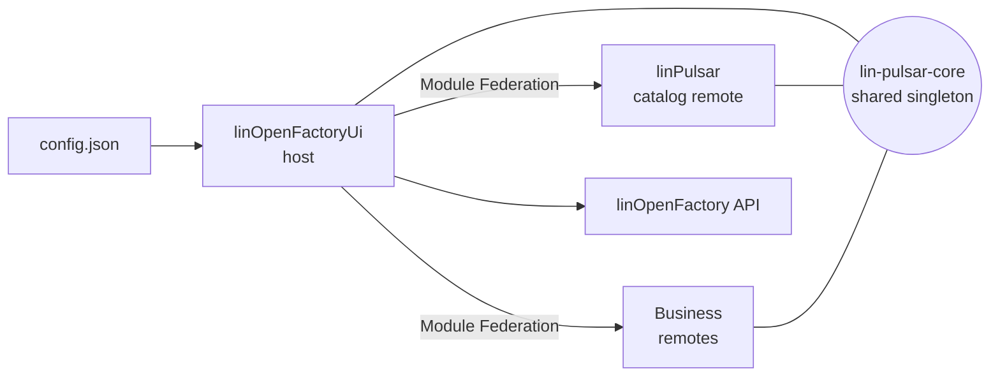

# **lin-pulsar-core**

## **🧩 Overview**

`lin-pulsar-core` is the core front-end library of **LinPulsar**, the component catalog of **linOpenFactory**.

linOpenFactory is a front-end and API building block to quickly create configurable applications. On the front-end
side, an application is made of:

| Part                 | Role                                                                                                  |
| -------------------- | ----------------------------------------------------------------------------------------------------- |
| **linOpenFactoryUi** | Default host application: bootstrap, BFF, authentication, loading of the application `config.json`.   |
| **linPulsar**        | Module Federation remote providing the component catalog: components, generic pages, default modules. |
| Business remotes     | Optional Module Federation remotes providing application-specific modules and components.             |
| **lin-pulsar-core**  | This library: the contracts and the shared runtime used by the host and by every remote.              |



lin-pulsar-core is shared as a **singleton** between the host and all remotes: every application part uses the same
HTTP client, i18n instance, Pinia stores, UI design and Module Federation instance, all provided by the host at boot.

---

## **✨ Features**

- **Module lifecycle**: standardized initialization of federated modules, driven by the application configuration
- **Zones**: injection of federated or host-local components into named zones of the UI
- **Configuration-driven entities**: entity and API endpoint configuration, generic CRUD service, field validation
- **UI design**: Quasar component props defined in configuration files, by namespace
- **Filters**: filter model, URL synchronization and saved searches stored as user preferences
- **Shared services and composables**: HTTP client, i18n, notifications, dialogs, dates, templates, formatters, tree
  and pagination helpers
- Shared **TypeScript types** for all of the above

---

## **Tech Stack 🛠️**

| Area            | Technology               |
| --------------- | ------------------------ |
| Language        | TypeScript               |
| Framework       | Vue.js (Composition API) |
| UI Toolkit      | Quasar Framework         |
| Module System   | Module Federation        |
| Package Manager | pnpm                     |

---

## **📋 Technical Prerequisites**

Ensure the following requirements to use or develop the library:

- **Node.js** ≥ 22.19
- **Package manager:** npm or pnpm to install the library, **pnpm ≥ 11** to develop it
- **Vue.js 3** project
- **Quasar Framework** if using UI components
- A bundler supporting **Module Federation** (Webpack 5, Vite, Rsbuild and Rspack)

---

## **📦 Installation**

Install the library from npm:

### **With npm**

```bash
npm install @linagora/lin-pulsar-core
```

### **With pnpm**

```bash
pnpm add @linagora/lin-pulsar-core
```

### **Peer dependencies**

The library expects the following exact versions, which must be the same in the host and in all remotes:

| Package                       | Version   |
| ----------------------------- | --------- |
| `vue`                         | `3.5.39`  |
| `quasar`                      | `2.21.1`  |
| `vue-router`                  | `5.1.0`   |
| `vue-i18n`                    | `11.4.6`  |
| `pinia`                       | `3.0.4`   |
| `axios`                       | `1.18.1`  |
| `rxjs`                        | `7.8.2`   |
| `dayjs`                       | `1.11.21` |
| `interactjs`                  | `1.10.27` |
| `@module-federation/enhanced` | `2.7.0`   |

### **Module Federation sharing**

The host and every remote must share the library as a strict singleton, so that they all use the same version and the
same instances:

```ts
federation({
  // ...
  shared: {
    '@linagora/lin-pulsar-core': {
      singleton: true,
      strictVersion: true,
    },
  },
});
```

---

## **📜 License**

This project is licensed under: GNU Affero General Public License version 3

---

## 📚 Documentation

A full technical documentation is available in the `docs/` directory.

- 🚀 **Getting Started**
  Start here: how to plug lin-pulsar-core into a host application and into a remote.
  → [`docs/getting-started.md`](docs/getting-started.md)

### Modules and zones

- 🔄 **Module Lifecycle System**
  Learn how the host initializes federated modules from the application configuration, and how modules hook into it.
  → [`docs/module-lifecycle.md`](docs/module-lifecycle.md)

- 🔌 **Plugin Zone Component (`LinPulsarZoneRenderer`)**
  Learn how to render federated or host-local components inside named zones.
  → [`docs/components-plugin-zones.md`](docs/components-plugin-zones.md)

### Services and types

- 🧰 **Services**
  Detailed description of all services provided by the library.
  → [`docs/services.md`](docs/services.md)

- 🧩 **TypeScript Types & Interfaces**
  Detailed description of all types and interfaces exported by the library.
  → [`docs/types-and-interfaces.md`](docs/types-and-interfaces.md)

### Entities, forms and filters

- ⚙️ **Field Validation (`useFieldValidation`, `useQuasarFieldValidation` & `useQuasarRules`)**
  Learn how to implement field validation compatible with Quasar framework.
  → [`docs/field-validation.md`](docs/field-validation.md)

- 🔍 **Filters (`LinPulsarFilter`, `LinPulsarFilterSet` & `LinPulsarFilterValue`)**
  Learn how to build filters, save them as favorite searches, and convert/parse filter value expressions.
  → [`docs/filters.md`](docs/filters.md)

- 🔗 **URL Filter Sync (`useLinPulsarFilterUrl`)**
  Learn how to use the `useLinPulsarFilterUrl` composable to synchronize `LinPulsarFilter` instances with the URL
  query params.
  → [`docs/use-lin-pulsar-filter-url.md`](docs/use-lin-pulsar-filter-url.md)

- ⚙️ **User Preferences System (`useLinPulsarUserPreference`)**
  Learn how to manage user preferences using the `useLinPulsarUserPreferenceStore` (Pinia state layer) and the
  `useLinPulsarUserPreference` composable (API synchronization layer with backend persistence).
  → [`docs/user-preference-system.md`](docs/user-preference-system.md)

### UI

- 🎨 **UI Design Configuration (`UiDesign`)**
  Learn how to initialize and use the `UiDesign` singleton and the `useUiDesign` composable for dynamic UI
  personalization.
  → [`docs/ui-design.md`](docs/ui-design.md)

- 🌐 **I18n Configuration (`i18n`)**
  Learn how to initialize and use the `i18n` singleton and the `useScopedI18n` composable for internationalization.
  → [`docs/i18n.md`](docs/i18n.md)

- 🔔 **Notification System (`useNotify`)**
  Learn how to use the `useNotify` composable to display notifications within your application.
  → [`docs/notify.md`](docs/notify.md)

- 💬 **Dialog System (`useDialog`)**
  Learn how to open and close dialogs through the shared UI event stream.
  → [`docs/dialog.md`](docs/dialog.md)

### Utilities

- 📄 **Pagination (`usePagination`)**
  Learn how to convert between backend pagination models and Quasar QTable pagination formats.
  → [`docs/pagination.md`](docs/pagination.md)

- 🌳 **Tree (`useTree`)**
  Learn how to convert between LinPulsar tree models and Quasar QTree component formats.
  → [`docs/tree.md`](docs/tree.md)

- 🔄 **Common Mapper (`useCommonMapper`)**
  Learn how to convert between data formats (ISO dates, locale formats, empty records, and Dayjs objects).
  → [`docs/common-mapper.md`](docs/common-mapper.md)

- 📅 **Dates (`useDayjs`)**
  Learn how to use the shared Dayjs instance to parse and compare dates.
  → [`docs/dayjs.md`](docs/dayjs.md)

- 🖨️ **Templates (`useNunjucks`)**
  Learn how to render Nunjucks templates used in configuration files.
  → [`docs/nunjucks.md`](docs/nunjucks.md)

- 🎯 **Value Formatting (`useValueFormatter`)**
  Learn how to apply named formatters declared in configuration to raw values before display.
  → [`docs/value-formatter.md`](docs/value-formatter.md)

- 📐 **Constants**
  Reference of the constants exported by the library.
  → [`docs/constants/index.md`](docs/constants/index.md)

---

## **🧭 Migrations**

Breaking changes come with a migration guide:

- [`0.0.x` → `0.1.0`](docs/migrations/0.X.0-0.1.0.md): renaming from `@linagora/linid-im-front-corelib` to
  `@linagora/lin-pulsar-core`

---

## **🤝 Contributing**

We welcome contributions to improve and extend this core library.
Please refer to the **[CONTRIBUTING.md](CONTRIBUTING.md)** file for:

- Development workflow
- Code guidelines
- Commit conventions
- Pull request rules
