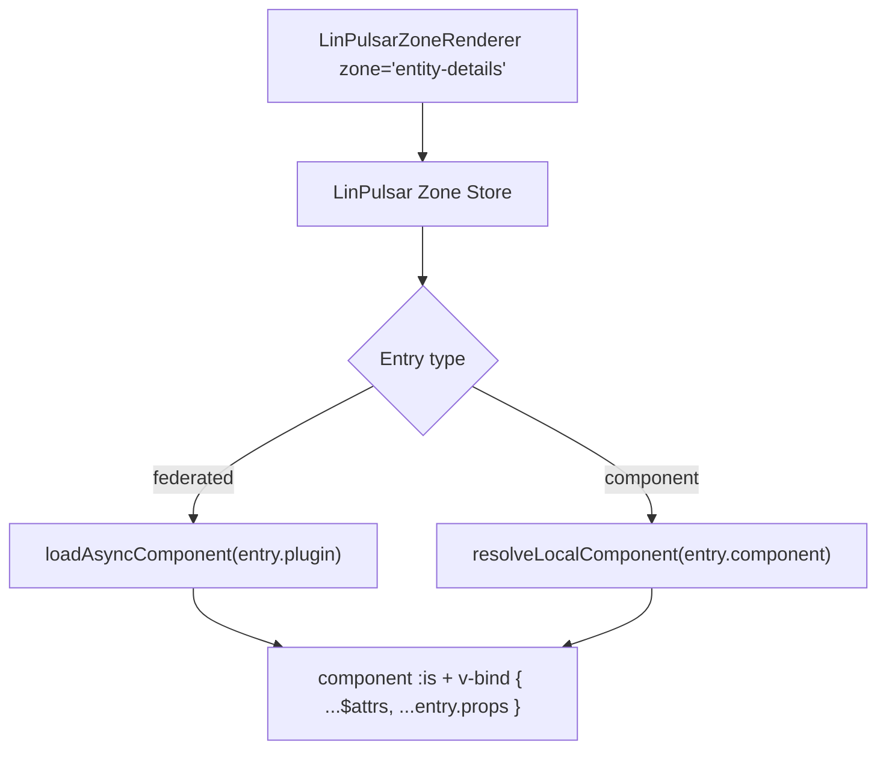

# LinPulsarZoneRenderer Component 🔌

The **LinPulsarZoneRenderer** component is a core feature of `lin-pulsar-core`.  
It allows the host application to **dynamically render remote Vue components (plugins) or components referenced by
name** inside predefined “zones” of the UI.

This component works together with the **LinPulsar Zone Store**, which manages plugin registration and provides reactive
updates.

---

## 🎯 Purpose

LinPulsarZoneRenderer provides:

- **Dynamic rendering:** Federated components are loaded asynchronously only when needed.
- **Plugin-based architecture:** Plugins registered during initialization are rendered automatically.
- **Named components:** A zone entry can also reference a component by name, without module federation.
- **Extensibility:** New features can be added via plugins without modifying the host app.
- **Standardization:** All entries follow the `LinPulsarZoneEntry` discriminated union.

---

## 🧱 How to Use the Component

### Basic Usage

```vue
<template>
  <LinPulsarZoneRenderer zone="entity-details" />
</template>
```

- `zone` (string): Identifier of the zone where components should be rendered.
- The component fetches all registered plugins for this zone from the store **at initialization time** and renders them
  asynchronously.

### Props

| Prop            | Type    | Description                                                                                                                                                                |
| --------------- | ------- | -------------------------------------------------------------------------------------------------------------------------------------------------------------------------- |
| `zone`          | string  | The name of the zone to render                                                                                                                                             |
| `...additional` | unknown | Any additional attributes and event listeners passed to the component are forwarded to all rendered zone plugins via `$attrs`. These is overriden by entry-specific props. |

**Example with additional attributes:**

```vue
<template>
  <LinPulsarZoneRenderer
    zone="entity-details"
    :entityId="42"
    :theme="dark"
  />
</template>
```

In this example, `entityId` and `theme` are forwarded to all plugins registered in the `entity-details` zone. A prop
with the same name defined in the zone entry configuration takes precedence over them. Event listeners (e.g. `@my-event`) would be
forwarded the same way.

### Default Slot - Fallback Component

The `LinPulsarZoneRenderer` component provides a **default slot** that is displayed when no components are registered in the
specified zone.

#### Purpose

The default slot allows you to:

- Display a custom message when a zone is empty
- Render a placeholder component
- Show alternative content for zones without plugins

#### Behavior

The slot is rendered **only when** no component is registered in the zone.

---

#### Usage

##### Default Fallback (No Custom Slot)

If you don't provide a custom slot, the component renders nothing:

```vue
<template>
  <LinPulsarZoneRenderer zone="sidebar" />
</template>
```

---

##### Custom Fallback Component

You can provide your own fallback content using the default slot:

```vue
<template>
  <LinPulsarZoneRenderer zone="entity-actions">
    <template #default>
      <div>
        <p>No actions available for this entity.</p>
      </div>
    </template>
  </LinPulsarZoneRenderer>
</template>
```

---

## 🔧 Configuring Zones in Module Configuration

Modules can declare elements that should be rendered in zones via their configuration file (`modules/<ModuleName>.json`). This
provides a **declarative, configuration-driven approach** to zone management.

### ModuleZoneDefinition Interface

The `ModuleZoneDefinition` interface standardizes how zones are declared in module configuration. An entry either
references an element exposed through module federation with `plugin`, or a component by name with `component`:

```typescript
interface FederatedModuleZoneDefinition<T = Record<string, unknown>> {
  /** Name of the target zone */
  zone: string;

  /** Remote/element name (e.g. "remoteA/componentB") */
  plugin: string;

  /** Optional element props (can be strongly typed) */
  props?: T;
}

interface ComponentModuleZoneDefinition<T = Record<string, unknown>> {
  /** Name of the target zone */
  zone: string;

  /** Name of the component to render (e.g. "QSeparator") */
  component: string;

  /** Optional element props (can be strongly typed) */
  props?: T;
}

type ModuleZoneDefinition<T = Record<string, unknown>> =
  FederatedModuleZoneDefinition<T> | ComponentModuleZoneDefinition<T>;
```

The two fields are **mutually exclusive**: the variant is determined by whichever of `plugin` or `component` is set, so
no extra discriminant is needed in the configuration file.

### Configuration Example

In your `modules/<ModuleName>.json` file:

```json
{
  "instanceId": "moduleComments-instance",
  "remoteName": "moduleComments",
  "entity": "comments",
  "apiEndpoint": "/api/comments",
  "lifecycleRemote": "linPulsar/PageLifecycle",
  "routesRemote": "linPulsar/PageRoutes",
  "i18nRemote": "linPulsar/EmptyI18n",
  "basePath": "/comments",
  "zones": [
    {
      "zone": "entity-details",
      "plugin": "moduleComments/CommentsCardPlugin",
      "props": {
        "showAvatar": true,
        "theme": "dark"
      }
    },
    {
      "zone": "sidebar",
      "plugin": "moduleComments/QuickActionsPlugin"
    },
    {
      "zone": "entity-details",
      "component": "QSeparator"
    }
  ],
  "options": {}
}
```

In this example, the module declares that its `CommentsCardPlugin` component should be rendered in the `entity-details`
zone, with a prop to show avatars. We suppose that `entity-details` is a zone exposed by another module, for example a
generic details page, allowing this Comments module to extend the details view with the comments of the entity.

The last entry references `QSeparator` by name instead of a federated element, which requires it to have been made
available to zones, see [Making Components Available to Zones](#-making-components-available-to-zones).

### Key Points

- **Declarative:** Zones are configured in JSON, separate from code
- **Type-safe:** The `props` field can be strongly typed when needed
- **Optional props:** If no configuration is needed, `props` can be omitted
- **Multiple zones:** A module can inject elements into multiple zones
- **Centralized:** All zone declarations are in one place
- **Static:** Zones must be known at build time for this approach
- **Integration:** The module lifecycle will automatically register these zones in the LinPulsar Zone Store during
  initialization

### When to Use Configuration vs. Store

| Approach                                                              | Use When                                                                                                        |
| --------------------------------------------------------------------- | --------------------------------------------------------------------------------------------------------------- |
| **Configuration** (`ModuleZoneDefinition`)                            | Static zone declarations known at build time, configuration-driven architecture, cleaner separation of concerns |
| **Store** (`registerPlugin`/`registerPluginOnce`/`registerComponent`) | Dynamic runtime registration, programmatic control needed, bootstrap-time setup in module lifecycle             |

Both approaches can coexist: use configuration for standard zones and the store for dynamic cases.

---

## ⚡ Adding an Entry with the Store

Entries must be registered in the **LinPulsar Zone Store** before they can be rendered.

### Federated Plugin Entry (`registerPlugin`)

```ts
import { useLinPulsarZoneStore } from '@linagora/lin-pulsar-core';

const linPulsarZoneStore = useLinPulsarZoneStore();

linPulsarZoneStore.registerPlugin('entity-details', '@/remote/EntityCard', {
  entityId: 42,
});
```

- `plugin`: Path or identifier of the remote component to load.
- `props`: Optional props passed to the plugin component.

### Named Component Entry (`registerComponent`)

A zone entry can also reference a component by name, without going through module federation. This is typically used by
the host application to inject its own components into zones exposed by generic pages.

```ts
import { useLinPulsarZoneStore } from '@linagora/lin-pulsar-core';

const linPulsarZoneStore = useLinPulsarZoneStore();

linPulsarZoneStore.registerComponent('entity-details', 'EntityCommentsCard', {
  entityId: 42,
});
```

- `component`: The name of the component to render (no asynchronous loading).
- `props`: Optional props passed to the component.

> The name must have been made available to zones beforehand, see
> [Making Components Available to Zones](#-making-components-available-to-zones).

> Because the component is referenced by name rather than by reference, this variant can also be declared from a module
> configuration file.

> Once registered **before the component mounts**, the `LinPulsarZoneRenderer` component will render this entry in the
> specified zone.

---

## 🧩 Making Components Available to Zones

Component entries carry a name, not a component reference, so that name has to be resolved at render time. The
`registerLocalComponent` and `registerLocalComponents` functions declare which components can be referenced this way.

```ts
import {
  registerLocalComponent,
  registerLocalComponents,
} from '@linagora/lin-pulsar-core';
import { QSeparator } from 'quasar';
import EntityCommentsCard from './components/EntityCommentsCard.vue';

registerLocalComponent('EntityCommentsCard', EntityCommentsCard);

registerLocalComponents({
  QSeparator,
});
```

This is typically done once during application bootstrap, before any zone is rendered.

### 🔎 Behavior

- Components are stored with `markRaw`, so they are kept out of the reactivity system.
- Registering a name that is already known **overrides** the previous component.
- Unknown names are **not** an error: `resolveLocalComponent` logs a warning and returns the name as-is, letting Vue
  resolve it against globally registered components.

> Declaring components explicitly gives the application control over its extension surface, and turns a typo in a
> configuration file into an actionable warning rather than a silently empty zone.

---

## 🔍 Checking Whether a Zone Has Entries (`hasZoneEntries`)

The **LinPulsar Zone Store** exposes a `hasZoneEntries` getter to know whether a zone holds at least one registered entry,
i.e. whether its `LinPulsarZoneRenderer` will actually produce content.

```ts
import { useLinPulsarZoneStore } from '@linagora/lin-pulsar-core';

const linPulsarZoneStore = useLinPulsarZoneStore();

if (linPulsarZoneStore.hasZoneEntries('entity-details')) {
  // The zone will render something
}
```

### 🔎 Behavior

- Returns `true` when the zone contains **at least one entry**, whatever its type (`federated` or `component`).
- Returns `false` when the zone contains no entry, or when the zone has never been registered at all.
- Unknown zones are handled safely: no error is thrown, `false` is returned.

---

## 🔁 Registering a Plugin Only Once (`registerPluginOnce`)

In some scenarios, a plugin must be registered **only once per zone**, even if the registration logic is executed
multiple times (for example, during repeated component mounts or micro-frontend initialization).

The **LinPulsar Zone Store** provides a `registerPluginOnce` method for this purpose.

### 🎯 Purpose

`registerPluginOnce` ensures that:

- A plugin is not duplicated in the same zone.
- Repeated initialization logic does not lead to multiple identical entries.
- Idempotent registration is guaranteed.

---

### 🧱 Usage

```ts
import { useLinPulsarZoneStore } from '@linagora/lin-pulsar-core';

const linPulsarZoneStore = useLinPulsarZoneStore();

linPulsarZoneStore.registerPluginOnce('entity-details', '@/remote/EntityCard');
```

### 🔎 Behavior

- Uniqueness is evaluated **based on the `plugin` identifier (its name/path)**, among federated entries only.
- If a plugin with the same `plugin` value is **not yet registered** in the specified zone → it is added.
- If a plugin with the same `plugin` value is **already registered** in the zone → the call is ignored.
- The comparison does **not** take `props` into account.
- No duplicate entries are created.
- Rendering remains reactive and unchanged.

> There is no `Once` variant for named component entries: the host controls its own bootstrap registrations.

---

### ⚠️ Important Recommendation

Although `registerPluginOnce` technically allows passing `props`, this is strongly discouraged.

Because uniqueness is determined **only by the `plugin` identifier**:

- Two registrations with the same `plugin` but different `props` will be treated as identical.
- The first registration wins.
- Subsequent calls will be ignored, even if their configuration differs.

For this reason:

> `registerPluginOnce` should only be used with **stateless or configuration-free plugins** (i.e., plugins without
> `props`).

If your plugin requires dynamic configuration or multiple differently configured instances, you should use
`registerPlugin` instead.

---

### ⚠️ Lifecycle Constraint

Entry registration must occur during the **module initialization phase** (i.e., within the module lifecycle bootstrap
logic).

The `registerPlugin`, `registerPluginOnce` and `registerComponent` methods are designed to be invoked only at
initialization time.

Any entry registered **after the module has completed its initialization** will **not be rendered or taken into account
** by `LinPulsarZoneRenderer`.

This constraint ensures architectural consistency and prevents unpredictable runtime mutations of the zone
configuration.

> In short: zone registration is a bootstrap-time operation, not a runtime dynamic mutation mechanism.

---

### ⚖️ `registerPlugin` vs `registerPluginOnce`

| Method               | Allows duplicates | Typical Use Case                             |
| -------------------- | ----------------- | -------------------------------------------- |
| `registerPlugin`     | ✅ Yes            | When multiple identical plugins are expected |
| `registerPluginOnce` | ❌ No             | When idempotent registration is required     |

---

### 📌 When to Prefer `registerPluginOnce`

Use `registerPluginOnce` when:

- A plugin represents a singleton UI contribution (e.g., a header badge, a global action button).
- Registration may run multiple times due to re-mounting or hot reload.
- You want to guarantee architectural safety against duplication.

Use `registerPlugin` when:

- Multiple instances of the same plugin are intentionally allowed.
- Order-sensitive or repeated rendering is required.

---

## 🧩 How It Works



1. **At initialization time**, the component retrieves all entries for the given `zone` from the **LinPulsar Zone Store**.
2. Each **federated entry** (`type: 'federated'`) is wrapped as an **async component** retrieved from its remote
   module using the `loadAsyncComponent(entry.plugin)` method. **Component entries** (`type: 'component'`) are
   resolved by name using `resolveLocalComponent(entry.component)`, without any asynchronous loading.
3. The component sets `inheritAttrs: false` to take manual control over attribute forwarding. This is required because
   the template has multiple root nodes (a fragment), so Vue cannot automatically determine which node should receive
   the inherited attributes. Disabling automatic inheritance allows each plugin to receive `$attrs` explicitly via
   `v-bind`.
4. All plugins in the zone are rendered sequentially with their props merged:

```vue
<component :is="entry.component" v-bind="{ ...$attrs, ...entry.props }" />
```

**Props merge behavior:**

- `entry.props`: Props from the zone entry configuration (from the module configuration file).
- `$attrs`: All attributes and event listeners passed to `LinPulsarZoneRenderer` that are not declared as props or emits.
  This includes bound props (e.g. `:entityId="42"`) as well as event listeners (e.g. `@my-event="handler"`). The `zone`
  prop is declared and therefore excluded from `$attrs` automatically.
  See [Vue Fallthrough Attributes](https://vuejs.org/guide/components/attrs) for details.
- **`entry.props` wins:** If the same key is present in both, the value from the zone entry is used.

**Example:**

```vue
<!-- In parent component -->
<LinPulsarZoneRenderer zone="entity-details" :theme="dark" :readOnly="true" />
```

In the zone configuration of `modules/<ModuleName>.json`:

```json
{
  "zone": "entity-details",
  "plugin": "myModule/EntityCard",
  "props": {
    "theme": "light",
    "showAvatar": true
  }
}
```

```ts
// Rendered component receives
{
  theme: 'light', // from entry.props, which wins over $attrs
  readOnly: true, // from $attrs
  showAvatar: true // from entry.props
}
```

- This allows multiple plugins to coexist in a single zone.
- The component loads plugins once during initialization and does not react to subsequent store changes.
- Props defined in the zone entry override the attributes passed to the zone renderer, so the attributes act as default
  values shared by all the entries of the zone.

---

## 🔧 Entry Types

Zone entries follow the `LinPulsarZoneEntry` discriminated union:

```ts
export interface BaseLinPulsarZoneEntry {
  /** Props forwarded to the rendered component */
  props?: Record<string, unknown>;
}

export interface FederatedLinPulsarZoneEntry extends BaseLinPulsarZoneEntry {
  type: 'federated';

  /** Path to the remote module */
  plugin: string;
}

export interface ComponentLinPulsarZoneEntry extends BaseLinPulsarZoneEntry {
  type: 'component';

  /** Name of the component to render */
  component: string;
}

export type LinPulsarZoneEntry =
  FederatedLinPulsarZoneEntry | ComponentLinPulsarZoneEntry;
```

- Entries are built by the store helpers (`registerPlugin`, `registerPluginOnce`, `registerComponent`); consumers
  never construct them manually.
- Props are automatically forwarded to the rendered component.
- Federated entries are wrapped in `loadAsyncComponent` for asynchronous loading; component entries are resolved by
  name with `resolveLocalComponent`.
- The `type` discriminant makes the model extensible for future entry kinds.

---

## ✅ Advantages

- **Decoupled architecture:** Plugins are independent of the host.
- **Lazy loading:** Federated components are only loaded when needed.
- **Performance optimized:** Entries are loaded once at initialization, avoiding unnecessary reactivity overhead.
- **Standardized interface:** All entries conform to the `LinPulsarZoneEntry` discriminated union.
- **Host injection:** The host can inject its own local components into zones without module federation.
- **Framework-friendly:** Works natively with Vue 3, Pinia, and Module Federation.

---

## 📌 Notes

- Multiple entries can be registered for the same zone; they are rendered in registration order.
- Entries must be registered **before the component is mounted** to be rendered.
- Use `hasZoneEntries(zone)` to know whether a zone will render anything.
- The component does not react to entries added after initialization.
- Failed imports are handled automatically; you can provide a `fallback` component.
- Designed for scalable front-end applications using Module Federation.
