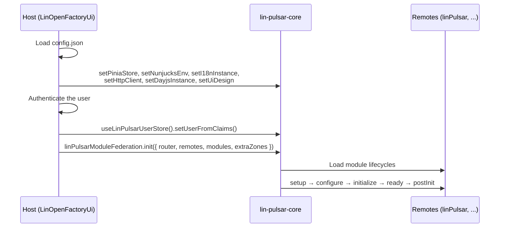

# 🚀 Getting Started

This guide explains how to plug lin-pulsar-core into a host application and into a remote. Each step links to the
detailed documentation.



---

## 1. Host application

The host application (by default `LinOpenFactoryUi`) owns the boot sequence: it creates the shared instances, hands
them to lin-pulsar-core, authenticates the user, then initializes the federated modules.

### 1.1 Load the application configuration

Everything starts from the application `config.json`, described in
[Application Configuration](./module-lifecycle.md#application-configuration):

```ts
const appConfig = await (await fetch('/config.json')).json();
```

### 1.2 Share the instances

The following instances must be shared **before** `linPulsarModuleFederation.init()` is called, since the module
lifecycle already relies on them (stores, route templates, i18n messages, HTTP calls):

| Setter             | Instance                      | Documentation                                             |
| ------------------ | ----------------------------- | --------------------------------------------------------- |
| `setPiniaStore`    | Pinia instance of the Vue app | [Pinia Store Service](./services.md#-pinia-store-service) |
| `setNunjucksEnv`   | Nunjucks environment          | [Nunjucks](./nunjucks.md)                                 |
| `setI18nInstance`  | vue-i18n instance (`i18n`)    | [i18n](./i18n.md)                                         |
| `setHttpClient`    | Axios instance of the BFF     | [HTTP Client Service](./services.md#-http-client-service) |
| `setDayjsInstance` | Dayjs instance                | [Dayjs](./dayjs.md)                                       |
| `setUiDesign`      | Merged `designFiles`          | [UI design](./ui-design.md)                               |

Their order does not matter, as long as they are all called before `init()` and before any component using them is
rendered. Each setter can only be called once: subsequent calls are ignored.

```ts
import {
  setDayjsInstance,
  setHttpClient,
  setI18nInstance,
  setNunjucksEnv,
  setPiniaStore,
  setUiDesign,
} from '@linagora/lin-pulsar-core';

setPiniaStore(pinia);
setNunjucksEnv(nunjucks.configure({ autoescape: false }));
setI18nInstance(i18n); // built from appConfig.i18n
setHttpClient(axios.create({ baseURL: '/backend' }));
setDayjsInstance(dayjs);
setUiDesign(uiDesign); // merged from appConfig.designFiles
```

The Module Federation instance is shared by `linPulsarModuleFederation.init()` itself: `setModuleFederation` does not
have to be called by the host.

### 1.3 Authenticate the user

Authentication is the responsibility of the host. Once the user is authenticated, the host fills the user store shared
with all remotes (see [LinPulsarUser](./types-and-interfaces.md#-linpulsaruser)):

```ts
import { useLinPulsarUserStore } from '@linagora/lin-pulsar-core';

useLinPulsarUserStore().setUserFromClaims(idTokenClaims);
```

### 1.4 Initialize the federated modules

Finally, the host registers the remotes and runs the lifecycle of every module declared in the configuration (see
[Host Responsibilities](./module-lifecycle.md#host-responsibilities)):

```ts
import { linPulsarModuleFederation } from '@linagora/lin-pulsar-core';

await linPulsarModuleFederation.init({
  router,
  remotes: appConfig.remotes,
  modules: appConfig.modules,
  extraZones: appConfig.extraZones,
  localComponents: {}, // host components available to zones and module configurations
});
```

---

## 2. Remote

A remote exposes components and modules through Module Federation, and uses the instances shared by the host.

### 2.1 Share lin-pulsar-core

The remote must share lin-pulsar-core as a strict singleton, along with the framework libraries shared by the host (see
[Installation](../README.md#-installation)). Otherwise, it would get its own copy of the library, without any of the
instances shared by the host.

```ts
federation({
  name: 'myRemote',
  filename: 'remoteEntry.js',
  manifest: true,
  exposes: {
    './MyComponent': './src/components/MyComponent.vue',
    './MyLifecycle': './src/federation/my-lifecycle.ts',
  },
  shared: {
    vue: { singleton: true },
    quasar: { singleton: true },
    pinia: { singleton: true },
    'vue-router': { singleton: true },
    'vue-i18n': { singleton: true },
    '@linagora/lin-pulsar-core': { singleton: true, strictVersion: true },
  },
});
```

The remote is then declared in the `remotes` entry of the application `config.json`:

```json
{ "name": "myRemote", "entry": "http://localhost:5002/mf-manifest.json" }
```

### 2.2 Expose components

Exposed components can be used in zones (see [LinPulsarZoneRenderer](./components-plugin-zones.md)) and as route
components of module configurations, using the `myRemote/MyComponent` notation. They use the shared instances through
the composables of lin-pulsar-core (`useScopedI18n`, `useUiDesign`, `useLinPulsarZoneStore`, ...).

### 2.3 Expose a module

A module is described by a configuration file listed in the `modules` entry of `config.json`. For a standard page, the
generic modules of the `linPulsar` catalog can be used as is:

```json
{
  "instanceId": "moduleMyEntityPage",
  "remoteName": "linPulsar",
  "entity": "myEntity",
  "lifecycleRemote": "linPulsar/PageLifecycle",
  "routesRemote": "linPulsar/PageRoutes",
  "i18nRemote": "linPulsar/EmptyI18n",
  "apiEndpoint": "my-entities",
  "basePath": "/my-entities",
  "zones": [],
  "options": {
    "layout": "linPulsar/BaseLayout",
    "page": "myRemote/MyEntityPage",
    "pagePath": ""
  }
}
```

A custom lifecycle is written with `createModulePageLifecycle` or by extending `BasicRemoteModule`, then exposed by
the remote and referenced by `lifecycleRemote` (see [Implementing a Module](./module-lifecycle.md#implementing-a-module)):

```ts
// src/federation/my-lifecycle.ts
import { BasicRemoteModule } from '@linagora/lin-pulsar-core';

class MyModule extends BasicRemoteModule<Record<string, unknown>> {
  constructor() {
    super('myModule', 'My module', '1.0.0', 'Module doing something.');
  }
}

export default new MyModule();
```
